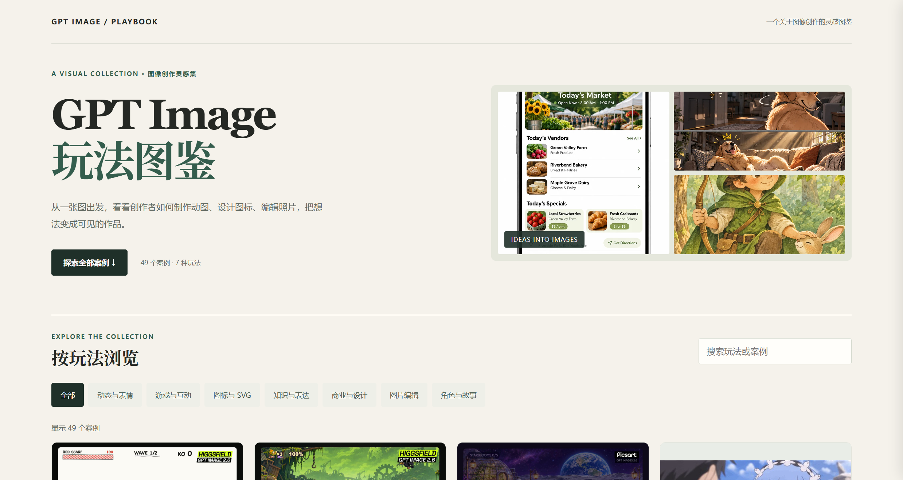
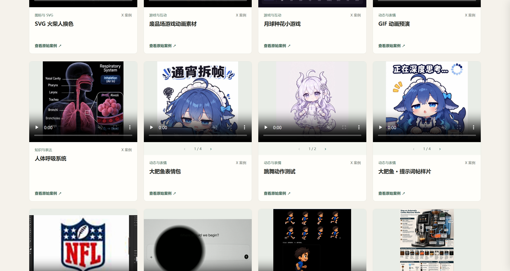

# Awesome AI Creative Gallery

[简体中文](README.md) · [English](README.en.md)

## Discover new ways to create with AI images

From animated characters and stickers to design edits, icons and website visuals, explore creative examples, find inspiration in the images and follow the original sources to learn more.

The collection currently focuses on the latest **GPT Image 2.6** ideas and now contains **122 cases**, including 30 verified X community cases (39–68) transferred from [awesome-gpt-images-2.6](https://github.com/xianyu110/awesome-gpt-images-2.6). More models are planned. **We will keep updating the gallery. Star the project to follow new ideas as they arrive.**

[](https://li-xiu-qi.github.io/awesome-ai-creative-gallery/) [](LICENSE) 

[](https://li-xiu-qi.github.io/awesome-ai-creative-gallery/)

## Find your next idea

Filter by use case or model, search by keyword and follow examples to their original sources. Cases without a confirmed model are marked accordingly. The bilingual gallery covers animation, stickers, games, icons, image editing, commercial design and more. Transferred community media lives under `assets/media/community-*`.



Some examples use other model versions or additional tools. Check the original sources for model versions and the actual workflows behind GIF and SVG results. Original links and creator attribution are shown on each card and indexed in the [Images 2.6 source gallery](https://github.com/xianyu110/awesome-gpt-images-2.6).

## Run locally

```bash
git clone https://github.com/li-xiu-qi/awesome-ai-creative-gallery.git
cd awesome-ai-creative-gallery
```

Open `index.html` in a browser. No dependencies or build step are required.

## Sources and license

Original code is available under the [MIT License](LICENSE). Third-party images, videos and works in screenshots belong to their respective rights holders and are not licensed under MIT by this project. Follow each example to its creator and terms of use. For rights concerns, please contact us through GitHub Issues.

This project is not officially affiliated with model providers.
