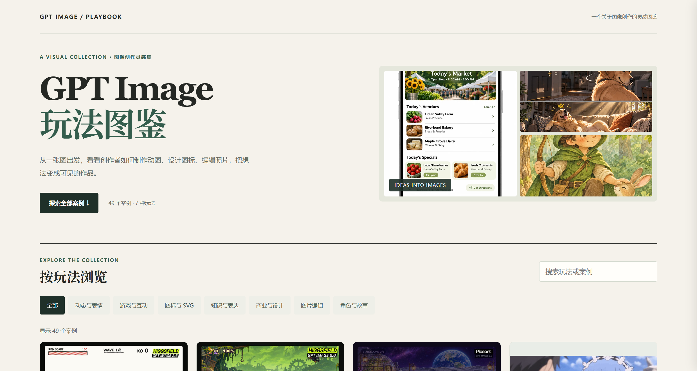
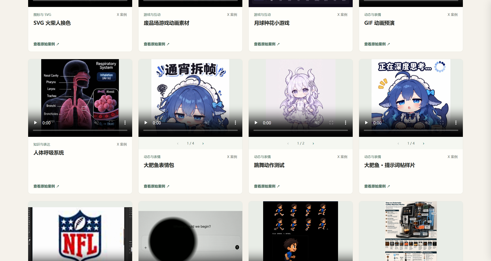

# Awesome AI Creative Gallery

[简体中文](README.md) · [English](README.en.md)

一份看得见作品、找得到来源的 AI 创作灵感图鉴。目前主要收集 GPT Image 2.6 的最新创作玩法，未来将扩展到更多模型。

[](LICENSE)  



**我们会持续更新**，收集有启发的创意、案例和原始来源。如果这个项目对你有帮助，欢迎 Star 关注更新。

## ✨ 探索图鉴

目前收录 49 个案例，涵盖动态与表情、游戏、图标、商业设计、图片编辑等 7 类玩法。支持中英文切换、关键词搜索和分类浏览，每个案例都提供原始来源。



部分案例用于比较其他版本或辅助说明创作方法，具体模型版本请以原始来源为准。GIF、SVG 等作品也可能结合其他工具制作。

## 🚀 本地使用

```bash
git clone https://github.com/li-xiu-qi/awesome-ai-creative-gallery.git
cd awesome-ai-creative-gallery
```

用浏览器打开 `index.html`，无需安装依赖或构建。

## 📎 来源与许可

项目原创代码采用 [MIT License](LICENSE)。案例图片、视频及截图中包含的第三方作品归各自权利人所有，不因本项目开源而获得 MIT 授权；请通过案例链接查阅原作者及其使用条件。如有素材权利问题，欢迎通过 GitHub Issues 联系我们。

本项目与相关模型厂商无官方关联。
